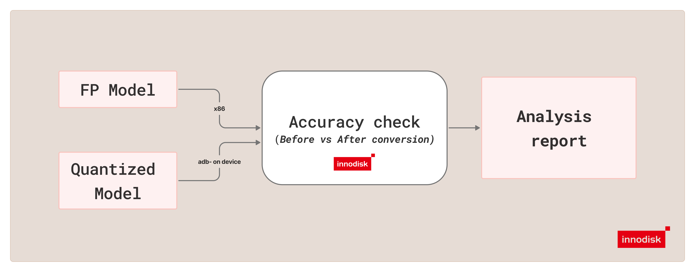

# eval Mode

`eval` mode compares a reference `.pt` model against a converted LiteRT, ONNX, or QAIRT counterpart
and reports how much the accuracy score changed between the two. The score depends on the task:
`mAP@0.5` for detection, keypoint and mask `mAP@0.5` for pose and segmentation, and top-1 / top-5
accuracy for classification (see [Tasks](#tasks)). Use this mode to validate whether the converted
model preserves the expected quality before moving to broader testing or deployment.



> [!TIP]
> **🤖 Using a coding agent?** If you use Claude Code, Codex or any other coding agent, you can run
> `eval` by chatting with the agent through the `iqf-assistant` skill. It also reformats labels
> that are not in a supported format, into a copy. Type `/iqf-assistant` or just ask, for example
> *"check the accuracy of my converted model"*. See [iQ-Foundry Assistant](iqf_assistant.md).

> [!IMPORTANT]
> Recommended host flow: run `./docker/iqf run eval ...`. If you repeat this workflow, save the
> required host paths first with
> `./docker/iqf configure eval --type <type> --runtime <runtime> --precision <precision>`. Saved
> paths live in `.iqf/docker-paths.json`.

> [!TIP]
> For detailed mode help, run `./docker/iqf run eval --help`.

## Supported Runtime and Precision Matrix

| Runtime | Precision | Converted model format |
| --- | --- | --- |
| `litert` | `int8` | `.tflite` |
| `litert` | `fp32` | `.tflite` |
| `onnx` | `fp32` | `.onnx` or compatible `.onnx.zip` bundle |
| `onnx` | `w8a16` | `.onnx` or compatible `.onnx.zip` bundle |
| `qairt` | `int8` | `.bin` HTP context binary |
| `qairt` | `w8a16` | `.bin` HTP context binary |
| `qairt` | `fp16` | `.bin` HTP context binary |

For host setup, start from [README.md](../README.md) and choose either
[Ubuntu_host.md](../Ubuntu_host.md) or [Windows_host.md](../Windows_host.md).

> [!IMPORTANT]
> ADB mode runs inside the container. If a host-side `adb` server already holds the USB
> interface, the container sees no device and the run fails with `no devices/emulators found`
> or an opaque non-zero exit. Release it on the host first:
>
> ```bash
> adb kill-server
> ```

## Tasks

`--task` selects what is evaluated. It defaults to `detect`, and `resnet50` always uses `classify`,
so you only need `--task` for pose and segmentation.

| `--task` | `--type` | Score | `--annotations` | `--images` |
| --- | --- | --- | --- | --- |
| `detect` | `yolov10`, `yolov11`, `yolov26` | `mAP@0.5` | COCO instances `.json`, a folder of YOLO `.txt`, or a folder of VOC `.xml` | One folder of pictures |
| `pose` | `yolov26` | Keypoint `mAP@0.5` (COCO OKS), also `mAP@0.5:0.95` | COCO keypoints `.json` (`person_keypoints_*.json`) or a folder of YOLO pose `.txt` | One folder of pictures |
| `segment` | `yolov26` | Mask `mAP@0.5`, also `mAP@0.5:0.95` | COCO instances `.json` with `segmentation` (`instances_*.json`) or a folder of YOLO segment `.txt` | One folder of pictures |
| `classify` | `resnet50` | Top-1 and top-5 accuracy | Not used | One sub-folder per class, see below |

- **VOC `.xml` is detection only.** It has no keypoints or masks, so pose and segmentation stop
  with an error.
- **YOLO pose `.txt`** lines are `class cx cy w h` followed by `x y [visibility]` per keypoint, all
  normalised. With these labels the keypoint scale is the box area times 0.53, as Ultralytics does,
  so the score is close to, not identical to, the COCO value.
- **YOLO segment `.txt`** lines are `class x1 y1 x2 y2 x3 y3 ...`, the polygon outline, normalised.
- **Classification** needs `--yaml`: the class names, in the model's output order. `eval` reads the
  pictures of each class from the sub-folder with that name. The folder names must be written as in
  the yaml:

  ```text
  /path/to/val/
  ├── tench/
  │   ├── 0001.jpg
  │   └── ...
  ├── English springer/
  └── ...
  ```

  `--max-images` takes pictures from every class in turn, so a small run still covers all classes.
  The report gives `reference_top1`, `converted_top1`, `reference_top5`, `converted_top5`, the
  differences, and `top1_agreement`, the share of pictures where both models pick the same class.
  For the `--yaml` format, see [test_mode.md](test_mode.md).

### Preparing the dataset

iQ-Foundry does not ship datasets. Download them yourself:

- **COCO (detect, pose, segment):** the pictures are in
  [val2017.zip](http://images.cocodataset.org/zips/val2017.zip). The labels are in
  [annotations_trainval2017.zip](http://images.cocodataset.org/annotations/annotations_trainval2017.zip):
  `instances_val2017.json` for detect and segment, and `person_keypoints_val2017.json` for pose.
- **Classification:** any folder with one sub-folder per class. See the folder layout in the
  Tasks section above.

Every picture listed in a COCO `.json` file must exist in `--images`, or the run stops. If you
evaluate only part of the pictures, use a `.json` file that lists only those pictures.

## Representative Commands

LiteRT FP32:

```bash
./docker/iqf run eval \
  --type yolov26 \
  --runtime litert \
  --precision fp32 \
  --annotations /path/to/instances_val2017.json \
  --images /path/to/val2017 \
  --reference-model /path/to/yolov26n.pt \
  --converted-model /path/to/yolov26_litert_fp32.tflite
```

ONNX Runtime FP32:

```bash
./docker/iqf run eval \
  --type yolov26 \
  --runtime onnx \
  --precision fp32 \
  --annotations /path/to/instances_val2017.json \
  --images /path/to/val2017 \
  --reference-model /path/to/yolov26n.pt \
  --converted-model /path/to/yolov26_onnx_fp32.onnx
```

For a smaller validation run, limit the number of images:

```bash
./docker/iqf run eval \
  --type yolov26 \
  --runtime onnx \
  --precision w8a16 \
  --annotations /path/to/instances_val2017.json \
  --images /path/to/val2017 \
  --reference-model /path/to/yolov26n.pt \
  --converted-model /path/to/yolov26_onnx_w8a16.onnx \
  --max-images 5
```

QAIRT INT8:

```bash
./docker/iqf run eval \
  --type yolov26 \
  --runtime qairt \
  --precision int8 \
  --annotations /path/to/instances_val2017.json \
  --images /path/to/val2017 \
  --reference-model /path/to/yolov26n.pt \
  --converted-model /path/to/yolov26_qairt_int8.bin \
  --max-images 5
```

Pose, segmentation and classification use the same options. Add `--task` for pose and segmentation:

```bash
./docker/iqf run eval \
  --type yolov26 \
  --task pose \
  --runtime litert \
  --precision int8 \
  --annotations /path/to/person_keypoints_val2017.json \
  --images /path/to/val2017 \
  --reference-model /path/to/yolo26n-pose.pt \
  --converted-model /path/to/yolov26_pose_litert_int8.tflite
```

For segmentation, use `--task segment`, an `instances_val2017.json` file and a `yolo26n-seg.pt`
reference. For classification, give the class folders and the class names instead of annotations:

```bash
./docker/iqf run eval \
  --type resnet50 \
  --runtime onnx \
  --precision w8a16 \
  --images /path/to/val \
  --yaml /path/to/classes.yaml \
  --reference-model /path/to/resnet50.pth \
  --converted-model /path/to/resnet50_classify_onnx_w8a16.onnx
```

## Purpose

`eval` mode is used to answer one question: how much model quality changed after the converted
model was produced.

In the current implementation:

- the reference model runs on the host
- the converted model runs on EXMP-Q911 (Qualcomm QCS9075) through ADB-managed execution
- the tool evaluates both outputs with the same dataset, postprocess thresholds, and the task's score (`mAP@0.5` for detection)
- the final report shows the reference score, converted score, absolute delta, percentage delta, and the trend

## Required Inputs

`eval` requires the following inputs:

- the wrapper subcommand `./docker/iqf run eval`
- `--type` with one of `yolov10`, `yolov11`, `yolov26`, or `resnet50`
- `--task` for `pose` and `segment` (the default is `detect`; `resnet50` uses `classify`)
- `--runtime` with one of `litert`, `onnx`, or `qairt`
- `--precision` with one of `fp32`, `int8`, `w8a16`, or `fp16`, in a supported combination (see
  the table above)
- `--annotations` pointing to either a COCO annotations JSON file or a custom annotation directory (not used for `classify`)
- `--yaml` with the class names, for `classify` only
- `--images` pointing to the matching image directory
- `--reference-model` pointing to the reference `.pt` model
- `--converted-model` pointing to the converted model:
  - LiteRT: `.tflite`
  - ONNX Runtime: `.onnx` or compatible `.onnx.zip`
  - QAIRT: `.bin` HTP context binary

When you use the wrapper, pass the path flags directly or save them first through
`./docker/iqf configure eval --type <type> --runtime <runtime> --precision <precision>`.

## Output

By default, `eval` writes the text report to:

```text
out/eval_results/<task>/<type>/<type>_eval_result_<runtime>_<precision>_<timestamp>.txt
```

`<task>` is `detect`, `pose`, `segment` or `classify`. For tasks other than `detect`, the file name also carries the task, for example `yolov26_pose_eval_result_litert_int8_<timestamp>.txt`.

Use `--output_text` to override the default location.

## How eval Mode Works

The current `eval` pipeline works as follows:

1. Validate the dataset, reference model, converted model, and selected runtime/precision pair.
2. Resolve the annotation source. COCO JSON is used directly; custom `.txt` or `.xml` labels are normalized into a temporary COCO JSON first.
3. Build category mapping from reference model class names to COCO category ids.
4. Resolve the reference output head and evaluation thresholds.
5. Prepare the target runtime: LiteRT and ONNX Runtime push the remote runner and provision the
   ADB-managed Python environment; QAIRT pushes only the context binary and input tensors and runs
   the target's own `qnn-net-run`.
6. Run reference inference on the host and converted-model inference on EXMP-Q911 (Qualcomm QCS9075) with the same evaluation images.
7. Postprocess both outputs with the same settings and evaluate them with `mAP@0.5`.
8. Write a summary report with reference `mAP`, converted `mAP`, and the resulting deltas.

## Custom Annotation Auto-Detection

When `--annotations` points to a directory, `eval` auto-detects the label format:

- `.txt` files only: treat the directory as YOLO text annotations
- `.xml` files only: treat the directory as VOC XML annotations
- both `.txt` and `.xml`: prefer `.txt` and print a warning that `.xml` was ignored

For custom datasets, reference model class names are the source of truth for category mapping:

- COCO categories are matched to reference model classes by category name, not by sorted category id
- non-contiguous or reordered COCO category ids are supported
- annotation categories may be a subset of the reference model classes
- predictions for classes that are not present in the annotation set are skipped during evaluation
- YOLO `.txt` class ids must still align with the reference model class indices
- VOC XML `<name>` labels must exactly match the reference model class names

The converted model must still match the reference model class count exactly.

For pose and segmentation, a YOLO `.txt` folder must hold the pose or segment label lines described in [Tasks](#tasks); a folder of `.xml` files is rejected.

`--yaml` is not used by `eval` for detect, pose and segment. It is required for `classify`.

## Default Reference Output Head

The reference output head is selected from `--type` unless you override it with `--fp-head`.

| `--type` | Default reference output head |
| --- | --- |
| `yolov10` | `one2many` |
| `yolov11` | `default` |
| `yolov26` | `one2many` |

For `yolov10` and `yolov26`, if the converted model was generated with `--qc-head one2one`, run
`eval` with `--fp-head one2one` so the reference branch matches the converted model. `yolov11`
always uses its default head and ignores `--fp-head`.

## Full eval Flags

| Flag | Purpose | Default |
| --- | --- | --- |
| `--type` | Select the model family. | Required |
| `--task` | Select the task: `detect`, `pose`, `segment` or `classify`. | `detect`, or `classify` for `resnet50` |
| `--runtime` | Select the deployment runtime. | Required |
| `--precision` | Select the deployment precision. | Required |
| `--annotations` | Path to a COCO annotations JSON file or a custom annotation directory. Not used for `classify`. | Required, except for `classify` |
| `--yaml` | Class names in the model's output order. `classify` only. | Required for `classify` |
| `--images` | Path to the image directory referenced by the annotations file. | Required |
| `--reference-model` | Path to the reference `.pt` model used as the quality baseline. | Required |
| `--converted-model` | Path to the converted `.tflite`, `.onnx`, compatible `.onnx.zip`, or `.bin` (QAIRT) model. | Required |
| `--output_text` | Path for the text report. | `out/eval_results/<task>/<type>/<type>_eval_result_<runtime>_<precision>_<timestamp>.txt` |
| `--conf` | Pre-NMS confidence threshold used during postprocess for both the reference and converted model paths. | `0.25` |
| `--fp-head` | Reference output branch override for `yolov10` and `yolov26`; use `one2one` when the converted model was created with `--qc-head one2one`. `yolov11` always uses `default`. | `one2many` for `yolov10` and `yolov26`, `default` for `yolov11` |
| `--nms` | NMS IoU threshold used during postprocess for both the reference and converted model paths. | `0.7` |
| `--max-det` | Maximum detections kept per image for both the reference and converted model paths. | `300` |
| `--max-images` | Number of images to evaluate across the entire run. | `300` |
| `--adb-serial` | ADB device serial for the target device. | first available device |
| `--remote-workdir` | Remote working directory on the target. | `/data/local/tmp/yolo_map_eval` |
| `--remote-runner-local` | Local path to the remote runner script. | LiteRT default: `tool/remote_tflite_raw_runner.py`; ONNX effective default: `tool/onnx_inference.py`; not used by QAIRT |
| `--remote-runner-remote` | Target path where the remote runner is pushed. | LiteRT default: `/data/local/tmp/yolo_map_eval/remote_tflite_raw_runner.py`; ONNX effective default: `/data/local/tmp/yolo_map_eval/onnx_inference.py`; not used by QAIRT |
| `--qnn-lib` | LiteRT delegate library path, ONNX Runtime QNN backend path, or QAIRT backend library. | LiteRT: `/usr/lib/libQnnTFLiteDelegate.so`; ONNX and QAIRT effective default: `libQnnHtp.so` |
| `--backend` | Delegate backend. Ignored by ONNX Runtime and QAIRT paths. | `htp` |
| `--no-qnn` | Disable the LiteRT QNN delegate or ONNX Runtime QNN EP and use the CPU path instead. Rejected by QAIRT. | off |


## Notes

- For `classify`, the YOLO options `--conf`, `--nms`, `--max-det`, `--fp-head` and `--topk` do not apply; giving one stops the run with an error.
- `eval` uses `--reference-model` and `--converted-model`. The old `--fp-model` and `--int-model` flags are deprecated and rejected.
- ONNX Runtime candidate paths accept `.onnx` and compatible `.onnx.zip` bundles. QAIRT candidate
paths accept the `.bin` context binary produced by `qc` mode, and provision nothing on the target. Bundles are extracted automatically before evaluation.
- It is recommended to start with the default settings. For `yolov10` and `yolov26`, if the converted model was produced with `--qc-head one2one`, update `--fp-head` to `one2one` so the reference path matches the converted model.
