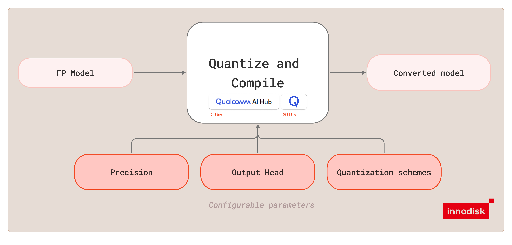

# QC Mode

`qc` mode prepares a supported `.pt` model (a YOLO model for detection, pose or segmentation, or a ResNet50 classifier) for deployment by converting it into a runtime-
specific artifact for EXMP-Q911 (Qualcomm QCS9075). Depending on `--runtime` and `--precision`, the
output is a LiteRT `.tflite` model, an ONNX `.onnx` model, or a QAIRT `.bin` HTP context binary.

`litert` and `onnx` convert through QAI Hub and need an API token. `qairt` converts entirely
offline with the SDK vendored under `vendor/qairt/`, so it needs no token and no network access.



> [!TIP]
> **🤖 Using a coding agent?** If you use Claude Code, Codex or any other coding agent, you can run
> `qc` by chatting with the agent through the `iqf-assistant` skill. Type `/iqf-assistant` or just
> ask, for example *"convert my model for the board"*. See [iQ-Foundry
> Assistant](iqf_assistant.md).

> [!IMPORTANT]
> Recommended host flow: run `./docker/iqf run qc ...`. If you repeat this workflow, save the
> required host paths first with
> `./docker/iqf configure qc --type <type> --runtime <runtime> --precision <precision>`. Saved
> paths live in `.iqf/docker-paths.json`.

> [!TIP]
> For detailed mode help, run `./docker/iqf run qc --help`.

## Supported Runtime and Precision Matrix

| Runtime | Precision | Output | Calibration |
| --- | --- | --- | --- |
| `litert` | `int8` | `.tflite` | Required |
| `litert` | `fp32` | `.tflite` | Ignored |
| `onnx` | `fp32` | `.onnx` | Ignored |
| `onnx` | `w8a16` | `.onnx` | Required |
| `qairt` | `int8` | `.bin` | Required |
| `qairt` | `w8a16` | `.bin` | Required |
| `qairt` | `fp16` | `.bin` | Ignored |

For host setup, start from [README.md](../README.md) and choose either
[Ubuntu_host.md](../Ubuntu_host.md) or [Windows_host.md](../Windows_host.md).

## Representative Commands

LiteRT INT8:

```bash
./docker/iqf run qc \
  --type yolov26 \
  --runtime litert \
  --precision int8 \
  --model /path/to/yolov26n.pt \
  --calib_dir /path/to/calibration_images
```

LiteRT FP32:

```bash
./docker/iqf run qc \
  --type yolov26 \
  --runtime litert \
  --precision fp32 \
  --model /path/to/yolov26n.pt
```

ONNX Runtime FP32:

```bash
./docker/iqf run qc \
  --type yolov26 \
  --runtime onnx \
  --precision fp32 \
  --model /path/to/yolov26n.pt
```

ONNX Runtime W8A16:

```bash
./docker/iqf run qc \
  --type yolov26 \
  --runtime onnx \
  --precision w8a16 \
  --model /path/to/yolov26n.pt \
  --calib_dir /path/to/calibration_images
```

QAIRT INT8:

```bash
./docker/iqf run qc \
  --type yolov26 \
  --runtime qairt \
  --precision int8 \
  --model /path/to/yolov26n.pt \
  --calib_dir /path/to/calibration_images
```

QAIRT W8A16:

```bash
./docker/iqf run qc \
  --type yolov26 \
  --runtime qairt \
  --precision w8a16 \
  --model /path/to/yolov26n.pt \
  --calib_dir /path/to/calibration_images
```

QAIRT FP16 (no calibration):

```bash
./docker/iqf run qc \
  --type yolov26 \
  --runtime qairt \
  --precision fp16 \
  --model /path/to/yolov26n.pt
```

## Required Inputs

`qc` requires the following:

- the wrapper subcommand `./docker/iqf run qc`
- `--type` with one of `yolov10`, `yolov11`, `yolov26`, or `resnet50`
- `--task` for `pose` and `segment` (the default is `detect`; `resnet50` uses `classify`)
- `--runtime` with one of `litert`, `onnx`, or `qairt`
- `--precision` with one of `fp32`, `int8`, `w8a16`, or `fp16`
- `--model` pointing to a supported FP `.pt` model, see [Model Requirements](#model-requirements)
- `--calib_dir` only for `litert/int8`, `onnx/w8a16`, `qairt/int8`, and `qairt/w8a16`

When you use the wrapper, pass the path flags directly or save them first through
`./docker/iqf configure qc --type <type> --runtime <runtime> --precision <precision>`.

For `litert/fp32`, `onnx/fp32`, and `qairt/fp16`, calibration is not part of the required UX:

- `--calib_dir` is optional and ignored if supplied
- `--max_calib` is ignored if supplied
- `--qc-quant-scheme` is ignored if supplied

## Model Requirements

**YOLO (`yolov10`, `yolov11`, `yolov26`):** the `.pt` file is an Ultralytics model of the matching
version. Pose and segmentation models (`yolo26n-pose.pt`, `yolo26n-seg.pt`) work only with
`--type yolov26`, and you must give `--task pose` or `--task segment`. Without `--task`, a pose or
segmentation `.pt` is converted as a detection-only model and the keypoints or masks are lost.

**ResNet50 (`resnet50`):** the `.pt` or `.pth` file must follow these rules.

- **Architecture:** torchvision `resnet50`, unchanged. The number of classes is read from the last
  layer (`fc`), so a model with your own number of classes works.
- **File content:** the `state_dict` only (weights saved with `torch.save(model.state_dict(), ...)`),
  not a whole pickled model.
- **Output:** raw class scores (logits). Do not add a softmax.
- **Input size:** 224 × 224. This is fixed.
- **Normalization:** train with the ImageNet mean `(0.485, 0.456, 0.406)` and standard deviation
  `(0.229, 0.224, 0.225)`, the torchvision default. A different normalization does not cause an
  error. The accuracy only drops.
- **Do not add the normalization to your model.** `qc` puts the mean and standard deviation in front
  of the converted model, so the board feeds plain 0-255 pixels, the same as for YOLO.
- **Picture preparation:** `eval`, `test` and the calibration pictures all use the same steps:
  RGB, resize the short side to 256, center-crop 224 × 224, divide by 255. If you trained with
  a different resize, the accuracy drops in the same way.

## Output

By default, `qc` writes the generated artifact to:

```text
out/model/<task>/<type>/<type>[_<task>]_<runtime>_<precision>_<timestamp>.<tflite|onnx>
```

`<task>` is `detect`, `pose`, `segment` or `classify`. `_<task>` is left out for `detect`. For the other tasks the file name carries the task, for example `yolov26_pose_litert_int8_<timestamp>.tflite`.

Examples:

- `out/model/detect/yolov26/yolov26_litert_int8_<timestamp>.tflite`
- `out/model/detect/yolov26/yolov26_litert_fp32_<timestamp>.tflite`
- `out/model/detect/yolov26/yolov26_onnx_fp32_<timestamp>.onnx`
- `out/model/detect/yolov26/yolov26_onnx_w8a16_<timestamp>.onnx`
- `out/model/classify/resnet50/resnet50_classify_onnx_w8a16_<timestamp>.onnx`

Use `--output` to override the default location.

## How QC Mode Works

`qc` mode runs the following high-level flow:

1. Validate the selected `--runtime` and `--precision` combination.
2. Validate the required inputs for that combination.
3. Resolve the effective export head, quantization scheme, and output path for the selected model type.
4. Run the matching pipeline: QAI Hub for LiteRT INT8/FP32 and ONNX FP32/W8A16, or the
   offline QAIRT toolchain (ONNX export -> DLC -> quantize -> HTP context binary) for QAIRT
   INT8/W8A16/FP16.
5. Download the generated artifact to the resolved output path.

For ONNX outputs, if QAI Hub returns a bundled ONNX artifact, iQ-Foundry extracts the public
`.onnx` entrypoint and keeps any required sidecar data next to it.

## Flags, Defaults, and Options

| Flag | Purpose | Options | Default |
| --- | --- | --- | --- |
| `--type` | Select the model family. | `yolov10`, `yolov11`, `yolov26`, `resnet50` | Required |
| `--task` | Select the task. Required for pose and segmentation. | `detect`, `pose`, `segment`, `classify` | `detect`, or `classify` for `resnet50` |
| `--runtime` | Select the deployment runtime. | `litert`, `onnx`, `qairt` | Required |
| `--precision` | Select the deployment precision. | `fp32`, `int8`, `w8a16`, `fp16` | Required |
| `--model` | Path to the FP `.pt` model. | filesystem path | Required |
| `--calib_dir` | Calibration image directory. Required for `litert/int8`, `onnx/w8a16`, `qairt/int8`, and `qairt/w8a16`; ignored for `litert/fp32`, `onnx/fp32`, and `qairt/fp16`. | filesystem path | runtime-dependent |
| `--output` | Override the output model path. | filesystem path | `out/model/<task>/<type>/<type>[_<task>]_<runtime>_<precision>_<timestamp>.<tflite|onnx|bin>` |
| `--max_calib` | Maximum calibration images used for quantized conversion. Ignored for FP32 flows. | integer | `200` |
| `--qc-head` | Override the export head for supported models. | `one2many`, `one2one` | `one2many` for `yolov10` and `yolov26`; ignored for `yolov11`, which uses `default` |
| `--qc-quant-scheme` | Override the quantization scheme for quantized conversion. Ignored for FP32 flows. | `mse`, `minmax` | `mse` for `yolov10`, `minmax` for `yolov11`, `mse` for `yolov26` and `resnet50` |


## Notes

- `resnet50` has no export head, so `--qc-head` is rejected for it.
- Calibration pictures should look like the data the model will see. For ResNet50, use pictures of the same kind as your classes, not unrelated ones.
- `litert/fp32`, `onnx/fp32`, and `qairt/fp16` do not require calibration data in configure flow or one-shot usage.
- `yolov11` always uses its default export head and ignores `--qc-head`.
- For `yolov10` and `yolov26`, keep `--qc-head` aligned with the branch you intend to evaluate later in `eval`.
- Saved wrapper paths are scoped by `type`, `mode`, `runtime`, and `precision`, so LiteRT, ONNX, and QAIRT entries do not overwrite each other.
